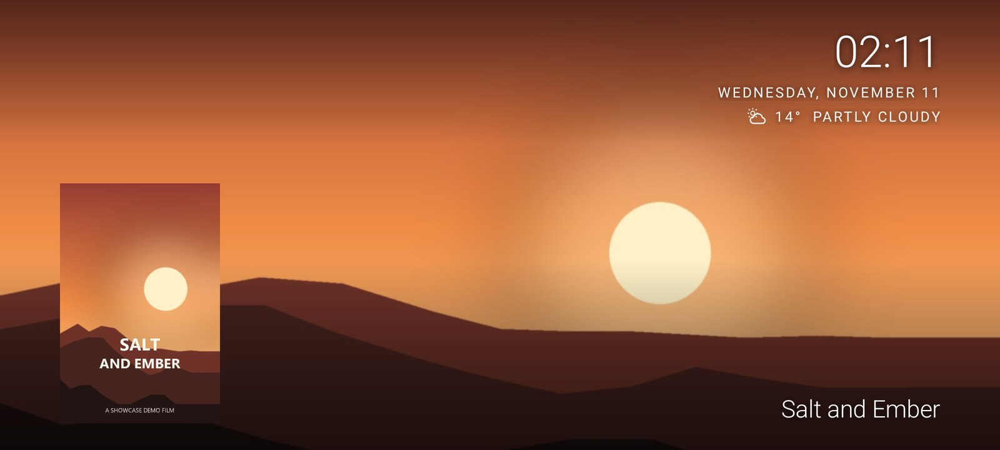
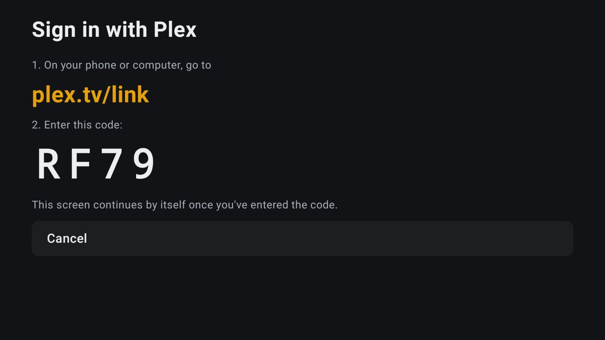
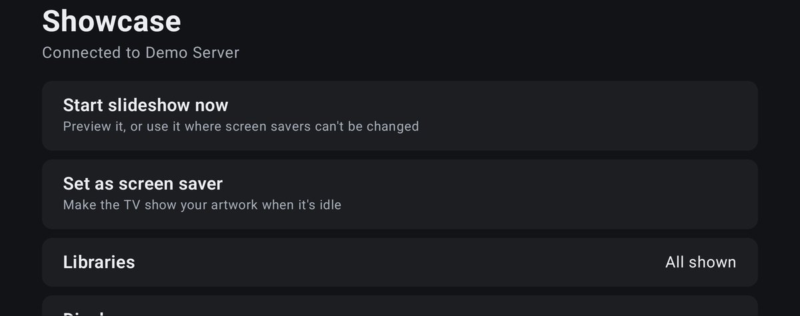

<p align="center">
  
</p>

<p align="center">
  Turn your TV into a gallery of your own movie and TV collection.<br>
  Sign in with Plex, pick your server, done.
</p>

<p align="center">
  
  <br><sub>Shown with demo artwork. On your TV it's the background art from your own Plex libraries.</sub>
</p>

---

## Two ways to run it

| | **Showcase for Android TV** (recommended) | **Showcase Web** |
|---|---|---|
| What it is | An app that **is** the TV's screensaver | A small server that serves the slideshow as a web page |
| Runs on | Nvidia Shield, Google TV, Chromecast, Android TV boxes, Fire TV, Android phones | Any always-on machine (Linux, Windows, Raspberry Pi…); viewed in any browser |
| Setup | Install, sign in with a code at plex.tv/link | Install Python, run, sign in on its settings page |
| Folder | [`android/`](android/) | [`web/`](web/) |

Both use the same "Sign in with Plex" flow and the same look, and neither needs you to copy tokens around.

## Features

- **Your own artwork:** full-screen background art from your Plex movie and TV libraries, in original quality (4K where Plex has it)
- **Sign in with Plex:** enter a short code at plex.tv/link, then pick your server. Showcase tests every address the server has and uses the best one: your local network first, the internet second, Plex Relay only as a last resort
- **Slideshow that feels like a cinema lobby:** slow pan and zoom, smooth crossfades, every title shown once before any repeats
- **Clock, date and weather:** in a clean, readable corner block; weather is optional and only needs your town name
- **Title and poster:** shown for each film or show, each can be turned off
- **Choose your libraries:** leave out any you don't want (music and photo libraries are skipped automatically)
- **Burn-in protection for OLED TVs:** the text moves a few pixels with each image
- **Works offline-ish:** the library list and artwork are cached, so it starts instantly and carries on if Plex blinks
- **Private by design:** your Plex token stays on the device or server, never shown, never sent anywhere but Plex

<p align="center">
  
  &nbsp;
  
</p>

---

## Install on Android TV

1. **Download** `Showcase-<version>.apk` from the [latest release](../../releases/latest).
2. **Install it** (sideload). Pick whichever is easiest:
   - **From a PC with adb:** turn on *Developer options → Network debugging* on the TV, then
     `adb connect <tv-ip>:5555` and `adb install Showcase-<version>.apk`
   - **On the TV:** use a downloader app (for example *Downloader* by AFTVnews) with the APK's link, and allow it to install unknown apps
3. **Open Showcase** from the apps row and choose **Sign in with Plex**. Enter the code at **plex.tv/link** and pick your server.
4. **Set it as the screensaver:** in Showcase choose **Set as screen saver**. It opens Settings, then go to
   *Device Preferences → Screen saver → Screen saver → Showcase*.

**Google TV and Fire TV** hide third-party screensavers in Settings. Set it once from a PC instead:
```
adb shell settings put secure screensaver_components app.showcase.screensaver/.slideshow.ShowcaseDream
```
Or use **Start slideshow now** in the app on any device.

More detail, including building it yourself, is in [`android/README.md`](android/README.md).

## Run Showcase Web

```
cd web
pip install -r requirements.txt
python app.py
```
Open `http://<server>:5005/screen/admin/`, enter the setup code printed in the terminal, create a password, and **Sign in with Plex**.
Point any browser, smart TV browser or "web page screensaver" app at `http://<server>:5005/screen/`.

Full guide (systemd, reverse proxies, security): [`web/README.md`](web/README.md).

---

## Privacy

- Your Plex token is stored only on the device (Android) or in the server's `.env` (Web), and only ever sent to Plex.
- Weather is optional. Only the town you choose is sent to [Open-Meteo](https://open-meteo.com), never your location.
- No analytics, no ads, no accounts other than your own Plex account.

## Credits and legal

- Weather data by [Open-Meteo.com](https://open-meteo.com) (CC BY 4.0).
- Showcase works with Plex but is **not affiliated with, endorsed by or sponsored by Plex, Inc.** "Plex" is a trademark of Plex, Inc.
- Artwork shown by the app comes from your own Plex server. The screenshots in this README use original demo artwork.

## License

[MIT](LICENSE)
