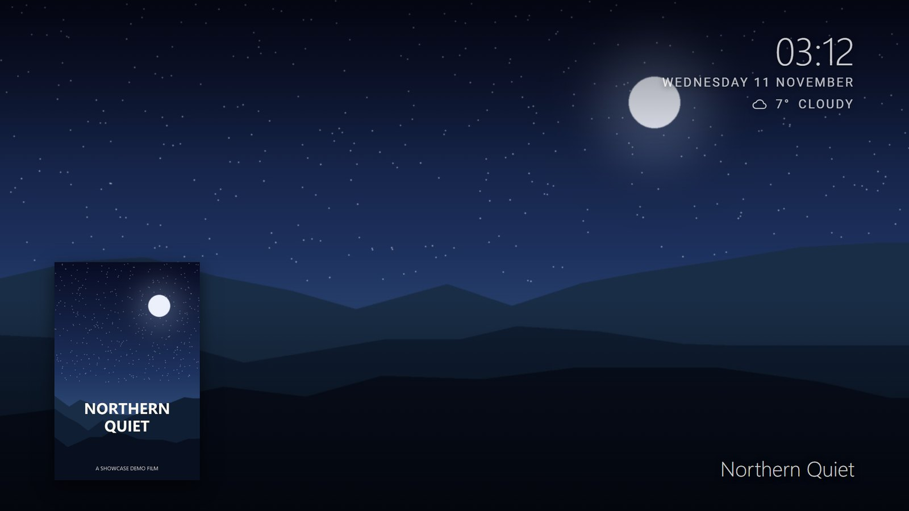

# Showcase Web

<p align="center"><br><sub>Shown with demo artwork.</sub></p>

A fullscreen slideshow of the artwork from your Plex movie and TV libraries, with title, clock and slow pan/zoom effects.
It comes with a settings page where you sign in with Plex, pick your server and libraries, and adjust everything with a live preview.

```
TV / browser  --->  Showcase Web server (python)  --->  your Plex Media Server
settings page       holds the Plex token
                    and every setting (.env)
```

---

## Setup (about 5 minutes)

### 1. Install
You need Python 3.10 or newer on any machine that can reach your Plex server. The Plex machine itself is fine.

Get the code one of two ways. Either is fine; they just end up in different folders:

| | How | The app folder (where `app.py` is) | To update |
|---|---|---|---|
| **Release zip** | Download `Showcase-Web-<version>.zip` from [Releases](https://github.com/s1dave-web/showcase/releases) and unzip it, e.g. into `/opt` | `/opt/showcase-web` | Stop the server, unzip the new version over it (your `.env` is kept), start it again |
| **git clone** | `git clone https://github.com/s1dave-web/showcase.git /opt/showcase` | `/opt/showcase/web` (the repo also holds the Android app) | `git -C /opt/showcase pull`, then restart the server |

Open a terminal in **the app folder** and run:
```
pip install -r requirements.txt
python app.py
```
(Optional but tidy: create a virtual environment first with `python -m venv venv`. Activate it with `venv\Scripts\activate` on Windows or `source venv/bin/activate` on Linux/macOS.)

The first time it runs, it creates `.env` and prints something like:
```
Screensaver:   http://localhost:5005/screen/
Settings page: http://localhost:5005/screen/admin/
FIRST RUN: open the settings page and enter setup code  81E8-C547  to create your password.
```

### 2. Create your password
From a device on the same network, open `http://<server-ip>:5005/screen/admin/`. Enter the **setup code** from the terminal and choose a password.

Running it as a systemd service? The code is in the journal: `sudo journalctl -u showcase | grep "setup code"`.
It stays the same across restarts until a password is set. Or skip it: run `python3 app.py --set-password` in the app folder.

### 3. Sign in with Plex
Click **Sign in with Plex** and approve Showcase Web in the Plex window that opens. Then choose your server.
Showcase Web tests each of the server's addresses and picks the best one that works: your local network first, then the internet, and Plex Relay only as a last resort.

### 4. Pick libraries and tweak
Untick any libraries you don't want, adjust the slideshow to taste, and click **Save changes**. The preview updates straight away. Screens pick up changes within about a minute.

### 5. Point your TV at it
Under **Screen access**, copy the address and set it as the page in your screensaver app.

---

## The settings page

| Section | What you can do |
|---|---|
| Plex server | Sign in with Plex, pick or switch server, or enter an address and token manually |
| Preview | A live view of the screensaver |
| Libraries | Choose which movie/TV libraries to show (music and photo libraries are never used) |
| Slideshow | Seconds per image, crossfade, image quality (original/4K or fit to screen), motion effects |
| On-screen text | Title and clock: show/hide, colour, opacity, position; 12/24-hour; date; **weather** (search for your town, °C or °F); corner poster; burn-in protection; **title logos**; **year, genre and rating** |
| Night dimming | Darken the screen between two times (each screen's own clock), and choose how much |
| Extra images | Mix in your own images (from `static/extraImages/`) or images from the web |
| Advanced | How often to check for new items; how long the server caches the library list |
| Screen access | Copy the TV address; require a key (or a new one) so only your screens can view it |
| Settings password | Change it (signs out other devices) |

It's built to be accessible: real labels, grouped fields, full keyboard use, announcements for screen readers, good contrast, light/dark mode, and it works on a phone.

### How the settings page is protected
- **Local network only** by default. Requests from the internet, including any that come through a reverse proxy, are refused. To allow remote access, set `ADMIN_ALLOW_REMOTE=true` in `.env`, and only do that behind HTTPS with a strong password.
- **The first password needs the setup code** printed in the server's terminal, so nobody can claim the page before you.
- **The password is stored only as a hash.** Lockout kicks in after 5 wrong attempts.
- **Plex tokens never reach the browser.** The page only ever sees "connected to *Server* as *user*".
- **Changes are protected against other websites** submitting them on your behalf (CSRF tokens and Origin checks).

Forgot the password? Run `python app.py --set-password`.

---

## Everything is in `.env`

The settings page reads and writes `.env`, and you can also edit it by hand. Every option is explained in `.env.example`.
Values in `.env` take priority over environment variables with the same name.

- **Live** (no restart): everything on the settings page, including the Plex connection and screen key.
- **Restart needed:** `HOST`, `PORT`, `SECRET_KEY`.

---

## Start automatically (optional)
- **Windows:** Task Scheduler → Create Task → Trigger *At startup*. Action: program `python` (or `venv\Scripts\python.exe`), arguments `app.py`, "Start in" = the app folder.
- **Linux (systemd):** create `/etc/systemd/system/showcase.service`. Set `WorkingDirectory` to **your app folder**:
  `/opt/showcase-web` if you used the release zip (as below), or `/opt/showcase/web` if you used git clone.
  ```
  [Unit]
  Description=Showcase Web
  After=network-online.target

  [Service]
  WorkingDirectory=/opt/showcase-web
  ExecStart=/usr/bin/python3 app.py
  Restart=always

  [Install]
  WantedBy=multi-user.target
  ```
  then `sudo systemctl enable --now showcase`. If you used a virtual environment, point `ExecStart` at its Python, e.g. `/opt/showcase-web/venv/bin/python app.py`. Logs, including the first-run setup code, are in `journalctl -u showcase`.

  **gunicorn works too**, e.g. `ExecStart=/usr/bin/gunicorn -w 4 -b 0.0.0.0:5005 app:app`. Every worker shares the same settings, logins and sign-in state through files in the app folder. With gunicorn, `HOST`/`PORT` in `.env` are ignored; the `-b` option decides. One process is plenty for a screensaver (`python3 app.py` runs 8 threads), so more workers only add memory use.

  **Run maintenance commands as the same user as the service** (`python3 app.py --set-password`). The app keeps `.env`'s owner and permissions when it saves, and logs a clear error if it ever can't read the file.

  The app keeps two small helper files next to `.env`: `.showcase-state.json` (Plex sign-ins in progress, login lockouts, setup code; owner-only) and `.showcase.lock`. Both are safe to delete while the server is stopped.

### Behind a reverse proxy
Forward `/screen/` to `http://<server>:5005/screen/`, keeping the `/screen` prefix, and require a screen key.
Make sure the proxy sends `X-Forwarded-For` (Caddy and Traefik do by default; for nginx add `proxy_set_header X-Forwarded-For $remote_addr;`), so the settings page knows those visitors are remote.
It's even simpler to block `/screen/admin/` at the proxy and only use the settings page at home.

---

## Troubleshooting

The screensaver shows problems in the top-left corner and retries automatically.

| Message | Fix |
|---|---|
| *Not set up yet* | Open the settings page and sign in with Plex. |
| *Could not reach the Plex server* | On the settings page, check the Plex status. Sign in again to re-test the addresses. |
| *Plex rejected the saved token* | Sign in with Plex again. This happens if you sign out of all devices in Plex. |
| *Access key missing or wrong* | Use the full address from **Screen access**, including `?key=`. |
| *No artwork found* | Every library is unticked, or none has background art. |
| Settings page says "only available from your local network" | You're coming from outside your network or through a proxy. See `ADMIN_ALLOW_REMOTE`. |

---

## Files

| File | What it does |
|---|---|
| `app.py` | Starts the server; screensaver routes and image proxy |
| `admin.py` | The settings page's server side (login, settings, Plex sign-in) |
| `plexapi.py` | Talks to Plex: your server, plus plex.tv for sign-in and server discovery |
| `settings.py` | Reads, validates and writes `.env` |
| `static/` | The screensaver page |
| `admin/` | The settings page |
